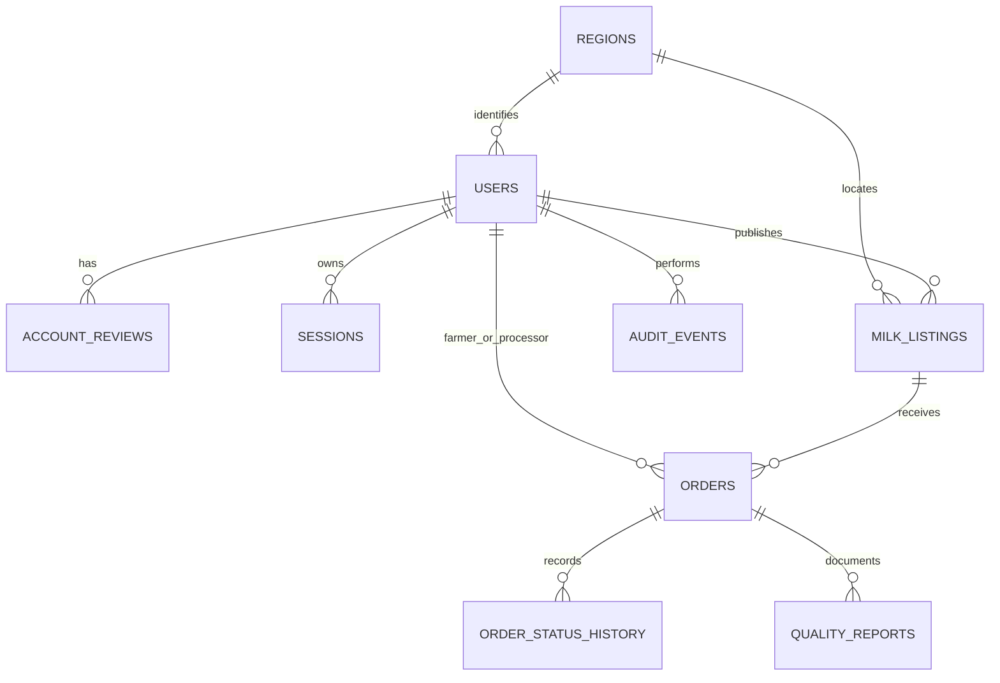

# ZaminFlow Backend: Step 0 Design Proposal

**Status: draft for product approval.** No backend implementation is included. Please approve or amend the domain model, endpoint inventory, account-approval rules, and dashboard metrics before implementation begins.

## Product and actors

ZaminFlow is a dairy marketplace in Uzbekistan. Farmers/producers publish milk they can supply; dairy processors find supply and place orders; platform administrators approve participants, oversee marketplace operations, and investigate audit events. The marketplace records fulfillment, but does not itself arrange transport or move money.

The only roles are `farmer`, `processor`, and `admin`. Public sign-up permits only `farmer` and `processor`; admin accounts are provisioned by `cmd/admin`. Admins do not trade. A farmer owns their listings and can accept or decline orders for them. A processor can browse published listings and place orders, then confirm receipt or raise a fulfillment issue. Delivery is represented by order-state changes made by the two trading parties, not by a logistics role.

## Proposed transaction lifecycle

1. A farmer or processor registers with a verified email, required identity/business details, and a pending account.
2. The applicant verifies their email. Only verified applicants appear in the admin review queue.
3. An admin approves or rejects the application, with the decision, reason, actor, and timestamp recorded in `account_reviews` and the audit log. Rejection can be corrected and resubmitted; each review attempt remains recorded.
4. An approved farmer publishes a listing with quantity, remaining quantity, quality attributes, region, and integer UZS price per liter.
5. An approved processor places an order against a listing. Creation atomically reserves the requested quantity so concurrent orders cannot oversell it.
6. The farmer accepts or rejects the order. The parties then update fulfillment milestones; the processor confirms receipt or opens a dispute. Allowed transitions and their actor are enforced server-side and recorded in order status history.

### Proposed order state machine

`placed -> accepted | rejected | cancelled`

`accepted -> ready_for_pickup -> picked_up -> delivered -> completed`

`accepted | ready_for_pickup | picked_up | delivered -> disputed`

The processor may cancel only before farmer acceptance; the farmer may reject a placed order; either party may open a dispute before completion. Farmer records `ready_for_pickup`, `picked_up`, and `delivered`; processor records `completed` after receipt. A dispute is terminal in the initial release and requires admin handling outside the API; automated resolution is not proposed. Each transition appends an immutable history record. Cancellation and rejection release reserved listing quantity. **Please confirm whether this is the desired operational workflow**, especially who records pickup and delivery.

## Proposed resources and ownership

| Resource | Main data | Ownership and lifecycle |
|---|---|---|
| User | UUID, role, account status, verified email, full name, phone, farm/company name, region, STIR, timestamps | User may edit their own profile; role is immutable by user. Account status is changed only by admin workflow. |
| Account review | Applicant, decision, reason, reviewer, timestamp, attempt number | Admin-only read/write; append-only decision history. |
| Session / refresh-token family | Hashed rotating refresh token, expiry, revocation/reuse metadata | Private to the authenticated user; admin suspension revokes every session. |
| Region | Stable code, Uzbek/Russian/English labels, active flag | Public read-only reference data, seeded from a maintained source. |
| Milk listing | Farmer, region, available liters, fat percentage, price per liter in UZS, availability dates, status | Farmer creates/updates own listing. `draft -> active -> paused | sold_out | expired`; only active listings are orderable. |
| Order | Listing, farmer, processor, liters, locked unit price, total UZS, status, requested pickup date, notes | Readable only by its two parties and admins; state transitions are actor-restricted. Price/quantity terms are snapshots at order placement. |
| Order status history | Order, old/new status, actor, timestamp, optional note | Immutable; visible to parties and admins. |
| Quality report | Order or listing, measurement values and units, reporter, timestamp | Proposed for recording quality at fulfillment; visibility limited to order parties and admins. Exact fields need approval. |
| Activity/audit event | Actor, action, target, request ID, timestamp, safe metadata | Security/admin events are admin-only; user activity is scoped to the user's own data. Secrets and sensitive authentication values are never stored. |

### Draft ER diagram

## Proposed endpoint inventory

All routes use `/api/v1`. UUIDs identify resources. All trading routes require a valid authenticated user with the route's role and a current DB account status of `approved`; admin routes require an admin with completed TOTP authentication. `GET /me`, own-profile operations, auth flows, and public metadata are not trading routes.

### Public and authentication

| Method and path | Access | Purpose |
|---|---|---|
| `GET /meta/roles` | Public | Return sign-up roles and user-facing labels; never return `admin` as selectable. |
| `GET /meta/regions` | Public | Return supported Uzbekistan region reference data. |
| `POST /auth/sign-up` | Public | Create pending farmer/processor account. |
| `POST /auth/email-verification/request` | Public | Send or resend verification email without account enumeration. |
| `POST /auth/email-verification/confirm` | Public | Verify a one-time email token. |
| `POST /auth/sign-in` | Public | Authenticate with generic errors; admins must provide TOTP or recovery code. |
| `POST /auth/refresh` | Refresh cookie / documented native-client mode | Rotate refresh token; detect reuse and revoke family. |
| `POST /auth/sign-out` | Authenticated | Revoke current refresh-token family. |
| `POST /auth/password-reset/request` | Public | Request reset without revealing account existence. |
| `POST /auth/password-reset/confirm` | Public | Consume one-time reset token and set a new password. |
| `GET /auth/sessions` | Authenticated | List the caller's active sessions. |
| `DELETE /auth/sessions/{sessionId}` | Authenticated | Revoke one of the caller's sessions. |
| `POST /auth/change-password` | Authenticated | Change password and revoke other sessions. |
| `GET /me` | Authenticated | Return profile, role, and live account status, including rejection reason. |
| `PATCH /me` | Authenticated | Edit allowed own-profile fields; rejected applicants may correct details. |
| `POST /me/resubmit` | Rejected farmer/processor | Return account to pending and append a review attempt. |
| `DELETE /me` | Authenticated | Request account deletion, subject to order/audit retention rules. |
| `POST /auth/totp/setup` | Admin, authenticated | Start mandatory admin TOTP enrollment; return secret once. |
| `POST /auth/totp/confirm` | Admin, authenticated | Confirm TOTP and issue one-time recovery codes. |
| `POST /auth/totp/recovery-codes/rotate` | Admin, MFA-authenticated | Replace recovery codes. |

### Admin approval and oversight

| Method and path | Access | Purpose |
|---|---|---|
| `GET /admin/applications` | Admin | Paginated/filterable/sortable verified pending applicants. |
| `GET /admin/applications/{userId}` | Admin | Applicant details and prior review attempts. |
| `POST /admin/applications/{userId}/approve` | Admin | Approve pending applicant. |
| `POST /admin/applications/{userId}/reject` | Admin | Reject with required reason. |
| `POST /admin/users/{userId}/suspend` | Admin | Suspend user with required reason and revoke all sessions. |
| `POST /admin/users/{userId}/reinstate` | Admin | Reinstate a suspended user; proposed target status is `approved`. |
| `GET /admin/audit-events` | Admin | Filterable audit trail. |
| `GET /dashboards/admin` | Admin | Admin dashboard aggregation. |

### Marketplace

| Method and path | Access | Purpose |
|---|---|---|
| `GET /listings` | Approved processor (and farmer for own listings only) | Search/paginate active listings; server-side filters and sorting. |
| `POST /listings` | Approved farmer | Create a listing. |
| `GET /listings/{listingId}` | Approved farmer owner or processor | Read listing. |
| `PATCH /listings/{listingId}` | Approved farmer owner | Edit allowed fields and availability. |
| `DELETE /listings/{listingId}` | Approved farmer owner | Archive listing if no active order reservation prevents it. |
| `GET /orders` | Approved farmer or processor | List only orders in which caller is a party. |
| `POST /orders` | Approved processor | Place order against an active listing. |
| `GET /orders/{orderId}` | Approved order party | Read order and status history. |
| `POST /orders/{orderId}/accept` | Approved farmer party | Accept placed order. |
| `POST /orders/{orderId}/reject` | Approved farmer party | Reject placed order with optional reason. |
| `POST /orders/{orderId}/cancel` | Approved processor party | Cancel before acceptance. |
| `POST /orders/{orderId}/status` | Approved order party | Submit only the next allowed fulfillment state. |
| `POST /orders/{orderId}/disputes` | Approved order party | Open a dispute before completion. |
| `POST /orders/{orderId}/quality-reports` | Approved order party | Record agreed quality measurements. |
| `GET /dashboards/farmer` | Approved farmer | Farmer dashboard aggregation. |
| `GET /dashboards/processor` | Approved processor | Processor dashboard aggregation. |

`GET /healthz` is an unauthenticated liveness check; `GET /readyz` checks database readiness. `GET /metrics` is internal/protected and is not public API functionality.

## Dashboard KPI and table definitions

Every dashboard response is computed from database rows, filtered to the authenticated user's scope and selected period. Proposed default period: trailing 30 days, UTC; supported periods: `7d`, `30d`, `90d`, `12m`, and `custom` with validated UTC `from`/`to`. All charts use UTC day buckets for periods up to 90 days and month buckets for 12 months. Empty datasets return zero-valued KPIs and empty arrays.

| Dashboard | KPI / chart / table | Proposed definition and source |
|---|---|---|
| Farmer | Milk sold (liters) | Sum order liters for this farmer where status is `completed`, completed in selected period; `orders`. |
| Farmer | Revenue (UZS) | Sum locked order total for the same completed orders and period; `orders`. Gross marketplace value, not net payout. |
| Farmer | Active listings | Count own listings with `active` state and positive available liters at request time; `milk_listings`. |
| Farmer | Orders awaiting response | Count own orders in `placed`; `orders`. |
| Farmer | Own vs market average price/liter | Own weighted mean `sum(total UZS)/sum(liters)` for completed orders in period vs weighted mean for all completed orders in same period. Exclude zero-volume rows; return `null` with no qualifying volume and identify market denominator as the platform. |
| Farmer | Quality trend | Monthly/period-bucket average of submitted quality measurements, grouped by metric and unit; `quality_reports`. Exact metric set subject to approval. |
| Farmer | Upcoming deliveries | Own accepted/fulfillment orders with expected pickup date on/after now, ordered by date, capped at 10. |
| Farmer | Recent activity | Latest 10 own listing/order events, newest first; derived from order history and listing timestamps. |
| Processor | Volume sourced | Sum completed order liters in period; `orders`. |
| Processor | Spend | Sum locked total UZS for completed orders in period; `orders`. |
| Processor | Active suppliers | Distinct farmer IDs on completed orders in period; `orders`. |
| Processor | Average price/liter | Weighted mean total UZS / liters on completed orders in period. |
| Processor | Supply by region | Completed liters grouped by farmer region in period; `orders`, `users`, `regions`. |
| Processor | Open orders | Count own orders not in `completed`, `rejected`, `cancelled`, or `disputed`; `orders`. |
| Processor | Incoming deliveries | Up to 10 own orders in accepted/fulfillment states, ordered by expected pickup date. |
| Processor | Quality acceptance rate | Completed order count with no quality rejection/ dispute divided by completed orders that have a recorded quality outcome in period; return numerator and denominator. **Requires explicit outcome fields in quality reports.** |
| Admin | Accounts awaiting approval | Verified, pending farmer/processor count plus oldest waiting duration and oldest applicant; `users`. |
| Admin | Accounts by role and status | Grouped user counts; `users`. |
| Admin | New sign-ups | Sign-up counts by day/month for selected period; `users.created_at`. |
| Admin | Platform volume and order value | Completed liters and locked UZS totals by period bucket; `orders`. |
| Admin | Active listings by region | Active listing count and available liters grouped by listing region; `milk_listings`. |
| Admin | Orders by status | Grouped order counts at request time; `orders`. |
| Admin | Recent security/audit events | Latest 20 relevant audit events with actor, action, target, request ID, and timestamp; redact sensitive metadata. |

Dashboard responses should include `period`, KPI objects with `value`, `unit`, and where applicable numerator/denominator, chart series, and bounded table rows. The design avoids follow-up calls for dashboard content. Please approve these definitions and the proposed quality-report fields.

## Approval workflow and security decisions

- Sign-up allows only `farmer` and `processor`; initial status is always `pending`. Role and status are not accepted from mutable profile updates.
- Email verification is required before entering the review queue. Pending users may verify email, sign in, view `GET /me`, and edit their own profile; they may not access marketplace or dashboard data.
- For any trading request, the server loads current role/status from the database, not token claims. Non-approved accounts receive `403` with a stable status-specific code: `account_not_approved`, `account_rejected`, or `account_suspended`.
- Admin approval/rejection/suspension/reinstatement run transactionally with the status change, review/audit record, and email enqueue. Use an outbox to avoid a committed decision silently losing its notification.
- Reject/suspend require a reason. A rejected user may correct profile data and resubmit; each attempt is retained. A suspended user cannot sign in; all refresh sessions are revoked in the same transaction.
- Admins cannot change their own status. Suspending or deleting the last active admin is rejected transactionally. Admins use mandatory TOTP with one-time hashed recovery codes, stricter rate limits, and audit records for each administrative action. `cmd/admin` provisions an admin in an enrollment-required state; the first password sign-in grants an enrollment-only session for TOTP setup, while all admin operations remain blocked until TOTP confirmation.
- Proposed access JWT lifetime is 15 minutes. Refresh tokens rotate on each use, are stored hashed, and are grouped into families; reuse of a revoked token revokes the family. Access tokens use a pinned algorithm and validate issuer, audience, expiry, and issued-at.
- Proposed web transport: access JWT in response body, sent via `Authorization: Bearer`; refresh token in `HttpOnly; Secure; SameSite=Lax` cookie scoped to `/api/v1/auth`; refresh requires exact allowed `Origin` plus a custom CSRF header. Native-client body transport is disabled unless explicitly enabled by deployment configuration.
- Passwords: minimum 12 characters, maximum 128, reject common passwords; hash using Argon2id with parameters benchmarked and documented. Uzbek phone format is `+998` plus nine digits and is normalized before storage. STIR format and region enumeration source need product confirmation.
- All list endpoints use `page` (1-based), `pageSize` (default 20, max 100), `total`, `items`; filters and sorts are documented per resource. IDs are UUIDs; JSON fields are camelCase; timestamps are RFC 3339 UTC; money is integer UZS; enum values are lowercase snake_case.
- Error envelope: `{ "error": { "code": "...", "message": "...", "requestId": "...", "fieldErrors": [{ "field": "...", "code": "...", "message": "..." }] } }`. Messages are safe for clients; codes are stable and localization-ready.

## Assumptions requiring approval

1. The marketplace is a listing/order/fulfillment ledger only. It does not collect payments, calculate taxes, transfer funds, or guarantee product quality.
2. Quantities use liters as whole-number integers. Fat is a percentage with bounded decimal precision; price and order totals are whole UZS integers. Please confirm whether fractional liters or other milk measurements are required.
3. Listing regions are Uzbekistan administrative regions; exact source and multilingual labels must be selected before seeding production data.
4. Farmer/company name, full legal name, Uzbek phone, region, and STIR are required at sign-up. Document upload is excluded for now.
5. Admin reinstatement returns a suspended account to `approved`; restoring a previously rejected user requires the application/resubmission flow.
6. A dispute is recorded and visible but resolved manually by admins outside the initial API.
7. Account deletion is a request rather than immediate hard deletion where orders, reviews, or audit retention obligations exist; final retention/anonymization policy needs legal review.
8. Market-price comparison means completed platform orders in the same time window, weighted by liters. It is not an external Uzbekistan market benchmark.
9. Quality acceptance requires explicit recorded outcome values and denominator rules; proposed definition excludes completed orders without a quality outcome.
10. CORS production allowlist includes `https://www.zaminflow.uz` and `https://zaminflow.uz`; local development includes localhost ports 3000 and 5173. Cookie Domain and API hostname depend on final deployment DNS.

## Explicitly out of scope for initial release

- Payment collection, escrow, payouts, invoices, tax computation, and external bank integrations.
- Logistics-provider accounts, route optimization, GPS tracking, and carrier integrations.
- Real-time chat, push notifications, ratings/reviews, bidding, and negotiation workflows.
- Document storage/uploads for applicants.
- Automated dispute adjudication and external market-price feeds.
- Mobile client, frontend/UI, and generated client implementation until the API contract is approved.

## Phase plan after approval

1. **Foundation:** Go module and pinned toolchain, config, structured logging, PostgreSQL, migrations, Docker/Compose, health/readiness endpoints, CI skeleton.
2. **Auth and approval:** registration, email verification, password reset/change, sign-in, MFA, rotating sessions, status gates, admin CLI, review workflow, transactional audit/outbox notifications.
3. **Domain and dashboards:** approved schema and transitions, listings/orders/quality, ownership checks, pagination/filtering/sorting, and all three database-backed dashboards.
4. **API consumer readiness:** finalize and validate OpenAPI, generated TypeScript client, Bruno/Postman collection, Swagger UI, frontend integration guide.
5. **Hardening and verification:** endpoint-by-endpoint security review, real-Postgres integration and black-box E2E tests, race/coverage, migrations up/down, fuzz/contract tests, load test, security and image scanning.
6. **Deployment and handoff:** production Compose/reverse proxy, backup and tested restore, deployment docs, final verification report and known risks.

## Approval requested

Please approve or amend the domain and order state machine, endpoint inventory, account approval and admin MFA rules, dashboard KPI definitions, and the assumptions above. Implementation remains paused until approval.
