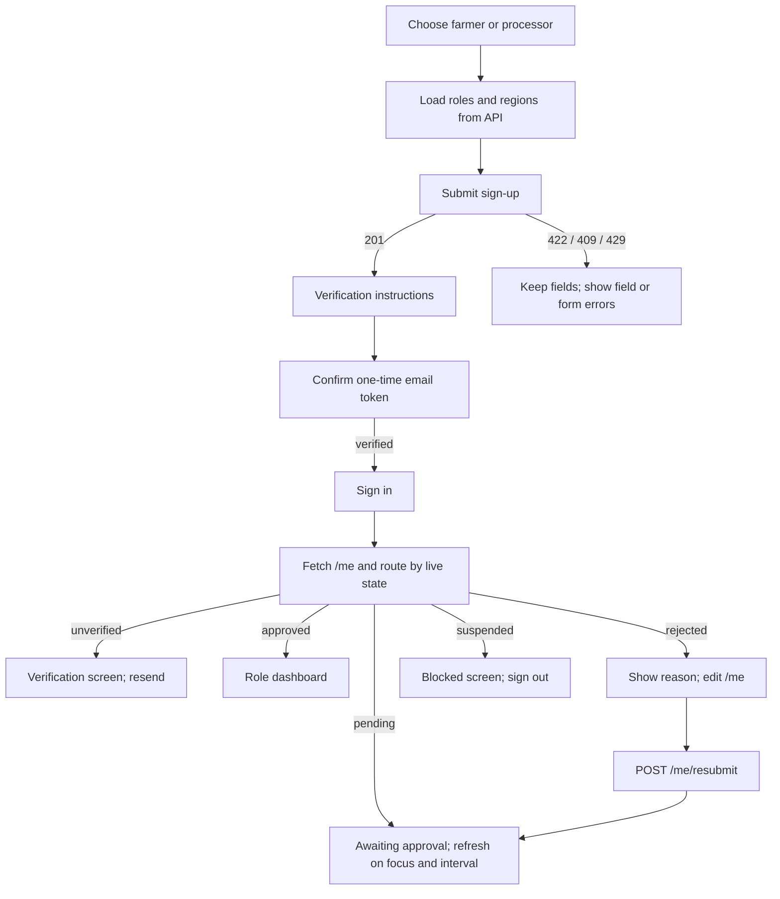
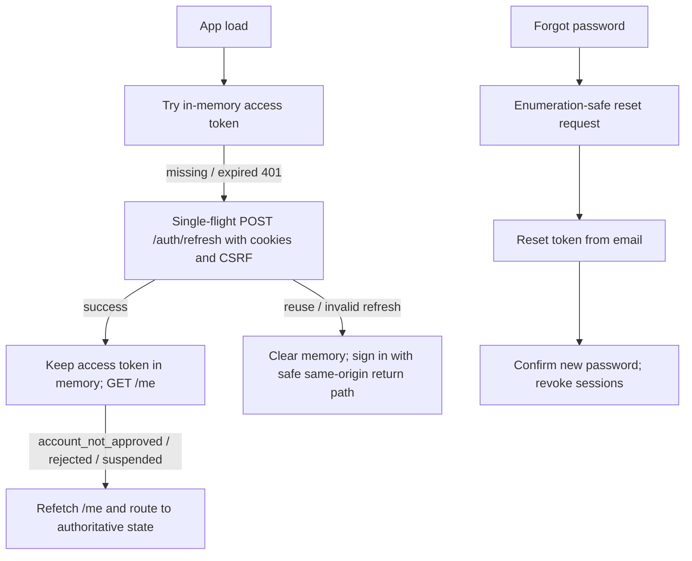
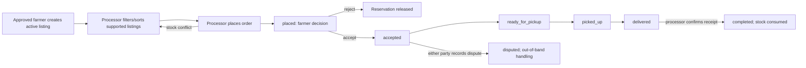
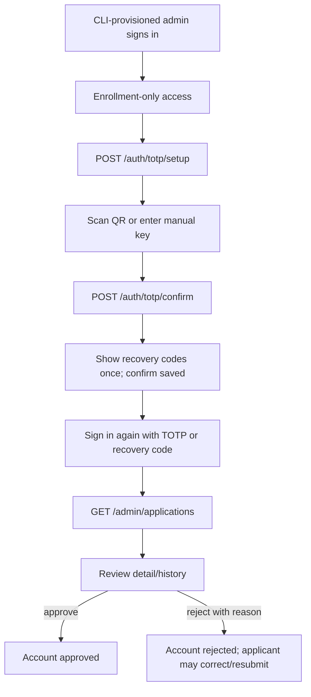

# Approved UX flows — constrained by current API

## Farmer/processor registration and approval

## Session restore, password reset and suspension

## Listing to order/receipt

## Admin TOTP and application decision

